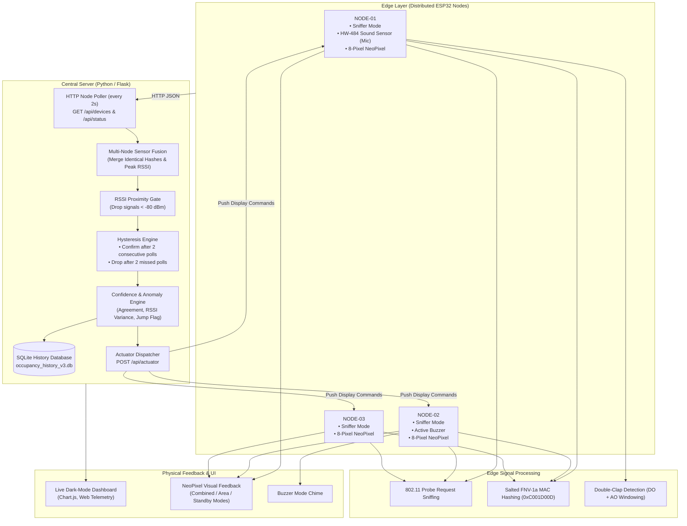

# WiFi-Based Occupancy Approximation for Power Management

A non-invasive, privacy-preserving, distributed IoT system that estimates real-time room occupancy by sniffing 802.11 Wi-Fi probe requests across multiple ESP32 nodes. The fused occupancy data provides automated awareness for dynamic power management, HVAC cycling, and smart lighting without cameras, wearable badges, or active user interaction.

---

## 📌 Project Overview

Traditional occupancy sensing suffers from major trade-offs:
- **PIR (Passive Infrared) Sensors:** Require direct line-of-sight and continuous movement; fail when occupants sit quietly at desks.
- **Computer Vision / Cameras:** Introduce severe privacy and surveillance concerns, require high compute, and perform poorly in variable lighting.
- **Smart Badges / RFID:** Require active user compliance.

This system leverages the ambient RF signals already broadcast by smartphones, smartwatches, and laptops:
1. **Zero Client Setup:** Detects unassociated 802.11 probe requests broadcast periodically by modern Wi-Fi devices.
2. **Privacy by Design:** Raw MAC addresses never leave the microcontroller. Hardware hashes device identifiers on-chip using a salted FNV-1a hash before transmission.
3. **Multi-Node Sensor Fusion:** Multiple ESP32 sniffer nodes cover large or partitioned spaces, merging overlapping detections to eliminate blind spots.
4. **Noise Rejection without Black-Box ML:** Employs an empirical **RSSI proximity gate** (eliminates hallway/wall bleed-through) and **candidate-confirmation hysteresis** (eliminates transient packet flicker).
5. **Acoustic Interaction & Physical Actuation:** An onboard microphone module listens for double-claps to cycle display modes across all nodes, accompanied by audio buzzer feedback and 8-pixel NeoPixel LED bar graphs.
6. **Live Telemetry Dashboard:** Central Python Flask server provides SQLite persistence and a dark-mode diagnostic interface with real-time occupancy graphs.

---

## 🏗️ System Architecture



---

## ⚡ Hardware Specifications & Pinout

### Node Hardware Overview
Each node is housed inside a custom transparent acrylic enclosure with an 8-LED NeoPixel strip and status indicators.

| Node ID | Primary Role | Microcontroller | Attached Modules |
| :--- | :--- | :--- | :--- |
| **NODE-01** | Input / Master Sensor | ESP-WROOM-32 | 8-Pixel NeoPixel Strip, HW-484 Sound Sensor |
| **NODE-02** | Audio Announcer / Sensor | ESP-WROOM-32 | 8-Pixel NeoPixel Strip, Active Buzzer |
| **NODE-03** | Display / Sensor | ESP-WROOM-32 | 8-Pixel NeoPixel Strip |

### GPIO Pin Mapping

#### All Nodes:
- **NeoPixel Data Pin:** `GPIO 4` (8x WS2812B / Adafruit NeoPixel)
- **Status LED:** `GPIO 2` (Heartbeat blink on operational; fast blink on network error)

#### NODE-01 (Microphone Node):
- **HW-484 DO (Digital Comparator Output):** `GPIO 34` (Pulse timing trigger)
- **HW-484 AO (Analog Level Output):** `GPIO 35` (Noise threshold gate, `CLAP_ANALOG_THRESHOLD = 150`)

#### NODE-02 (Buzzer Node):
- **Buzzer Signal Pin:** `GPIO 16` (Plays distinct multi-tone chime on mode transition)

---

## 🧠 Core Engineering Principles

### 1. Privacy-Preserving MAC Hashing (Edge Security)
To comply with user privacy and prevent tracking personal hardware identifiers:
- Device MAC addresses are intercepted in volatile RAM inside the ESP32 promiscuous callback.
- The MAC is immediately hashed using the **FNV-1a 32-bit algorithm** combined with a static shared salt (`0xC001D00D`):
```cpp
static uint32_t hashMac(const uint8_t* mac) {
    uint32_t hash = 2166136261u ^ HASH_SALT;
    for (int i = 0; i < 6; i++) { 
        hash ^= mac[i]; 
        hash *= 16777619u; 
    }
    return hash;
}
```
- Raw MAC addresses are never printed to serial logs, stored in flash, or transmitted over Wi-Fi. Because the salt is shared across all nodes, the same device generates the identical hash on all nodes, enabling seamless multi-node fusion.

### 2. Eliminating Wall Bleed-Through (RSSI Proximity Gate)
In dense buildings (e.g., apartments, offices, dormitories), Wi-Fi probe requests penetrate walls. Counting raw signals causes significant overcounting from adjacent rooms and corridors.
- **Rule:** A device whose peak observed RSSI across all nodes is weaker than `RSSI_PRESENCE_THRESHOLD` (`-80 dBm` by default) is gated out before counting.
- Empirically calibrated: devices outside the room perimeter fall below the -80 dBm cutoff.

### 3. Debouncing & Flicker Suppression (Candidate Hysteresis)
Wi-Fi probe transmissions are non-deterministic and can suffer RF packet collisions.
- **Candidate Phase:** When a new hash is first observed, it enters candidate status. It must appear in `CONFIRM_AFTER_POLLS` (default: 2 consecutive 2-second polls) before being tallied in `confirmed_occupancy`.
- **Missed Phase:** When a confirmed device misses a beacon, it is not dropped immediately. It must be absent for `DROP_AFTER_MISSED_POLLS` (default: 2 consecutive missed polls) before removal.
- Independent from the ESP32’s on-board device eviction timer (`DEVICE_TIMEOUT_MS = 30000 ms`), this second layer of debounce prevents graph flicker.

### 4. Acoustic State Machine & Single Source of Truth
Instead of requiring microcontrollers to negotiate mode states with each other or push fragile HTTP requests to the server:
- **NODE-01** measures sound bursts using dual DO/AO sampling within a temporal window (120ms – 700ms). When a double-clap is detected, it simply increments an internal integer counter exposed at `/api/status`.
- The central Python server polls this counter every 2 seconds. When it detects an increment, it cycles the global mode state and pushes the new configuration down to all three nodes via `POST /api/actuator`.
- **NODE-02** detects the mode shift in its incoming actuator payload and plays a confirmation chime.
- **Fail-Safe Watchdog:** If any node misses an actuator packet for >60 seconds (`ACTUATOR_STALE_MS`), the NeoPixel strip falls back to a slow breathing amber glow instead of freezing on stale data.

---

## 💡 Physical Display Modes

Users can toggle through 3 display modes via a double-clap:

| Mode | Visual Behavior | Meaning |
| :--- | :--- | :--- |
| **Combined** | Identical green/cyan LED bar graph on all 3 strips | Displays the total fused confirmed occupancy count for the entire room. |
| **Area** | Local count displayed per node; brightness scaled relative to the busiest node | Highlights zone density; strips in less occupied areas automatically dim down. |
| **Standby** | Steady warm-white ambient light across all strips | Decorative ambient light mode; decouples strips from occupancy tracking. |

---

## 📊 Live Diagnostic Dashboard

The server hosts a responsive, dark-mode real-time dashboard accessible via standard web browser:

- **Confirmed Occupancy Gauge:** Displays clean, debounce-filtered occupant count.
- **Sensor Quality Confidence Score (%):** Computed dynamically based on:
  - Node uptime and availability.
  - Inter-node count agreement (`node_agreement`).
  - RSSI variance and multi-node device triangulation.
- **Anomaly / Unusual Jump Indicator:** Flags unexpected step-function changes in room density.
- **Interactive Multi-Series Time-Series Chart:** Visualizes fused confirmed count against raw node counts over time using Chart.js.
- **Sensor Diagnostics Table:** Live view of mean RSSI, signal variance, and probe arrival rates.

---

## 📁 Repository Structure

```text
├── backend/
│   ├── node1.cpp               # Firmware for NODE-01 (Mic + NeoPixel + Sniffer)
│   ├── node2.cpp               # Firmware for NODE-02 (Buzzer + NeoPixel + Sniffer)
│   ├── node3.cpp               # Firmware for NODE-03 (Display + Sniffer)
│   ├── server.py               # Central fusion engine, REST API & Flask web dashboard
│   ├── occupancy_history_v3.db # SQLite database storing diagnostic time-series data
│   └── occupancy_history.db    # Legacy database archive
├── src/
│   └── main.cpp                # Active PlatformIO build target (flashed to target node)
├── include/                    # Project header files
├── lib/                        # Local shared embedded libraries
├── test/                       # Unit tests
├── platformio.ini              # PlatformIO configuration & dependencies
└── README.md                   # Project documentation
```

---

## 🚀 Getting Started

### Prerequisites

#### Hardware:
- 3x ESP32 Development Boards (NodeMCU ESP32 / ESP32-WROOM-32)
- 3x 8-pixel WS2812B NeoPixel sticks
- 1x HW-484 Microphone module
- 1x Active/Passive Buzzer
- Micro-USB cables & 5V power sources

#### Software:
- [PlatformIO IDE](https://platformio.org/) (VS Code Extension) or PlatformIO Core CLI
- Python 3.8+
- SQLite3

---

### Step 1: Flashing the ESP32 Nodes

1. Open the repository in VS Code with PlatformIO installed.
2. Select the firmware source file for the target board from `backend/`:
   - Copy `backend/node1.cpp` into `src/main.cpp` for **NODE-01**.
   - Copy `backend/node2.cpp` into `src/main.cpp` for **NODE-02**.
   - Copy `backend/node3.cpp` into `src/main.cpp` for **NODE-03**.
3. In `src/main.cpp`, configure your local Wi-Fi credentials and static IP allocations:
   ```cpp
   constexpr const char* WIFI_SSID     = "YOUR_WIFI_SSID";
   constexpr const char* WIFI_PASSWORD = "YOUR_WIFI_PASSWORD";
   constexpr uint8_t STATIC_IP_LAST_OCTET = 201; // 203 for Node 1, 202 for Node 2, 201 for Node 3
   ```
4. Build and upload via PlatformIO:
   ```bash
   pio run --target upload
   ```

---

### Step 2: Running the Backend Server

1. Navigate to the `backend/` directory:
   ```bash
   cd backend
   ```
2. Install Python dependencies:
   ```bash
   pip install flask requests
   ```
3. Update the node IP addresses in `server.py` to match your local network:
   ```python
   NODES = {
       "NODE-01": "http://192.168.137.203",
       "NODE-02": "http://192.168.137.202",
       "NODE-03": "http://192.168.137.201",
   }
   ```
4. Start the fusion server:
   ```bash
   python server.py
   ```
5. Open your browser and navigate to:
   ```text
   http://localhost:8000
   ```

---

## ⚙️ Configuration Knobs

All critical tuning parameters can be modified at the top of `backend/server.py`:

```python
# Signal filter cutoff: drop probe requests weaker than this (dBm)
RSSI_PRESENCE_THRESHOLD = -80

# Consecutive successful polls before marking device as confirmed
CONFIRM_AFTER_POLLS = 2

# Consecutive missed polls before dropping device from confirmed count
DROP_AFTER_MISSED_POLLS = 2

# Polling frequency for nodes (seconds)
POLL_INTERVAL_S = 2

# In-memory history buffer size for the web dashboard chart
HISTORY_SIZE = 1800
```

---

## 💡 Practical Power Management Applications

The output of this system (`confirmed_occupancy`) is designed to trigger automated energy conservation actions via relay modules, MQTT, or Home Assistant integrations:

1. **Intelligent HVAC Setback:**
   - When `confirmed_occupancy == 0` for >10 minutes, dial back climate control to eco mode.
   - When occupancy ramps up, dynamically increase airflow proportional to confirmed count.
2. **Automated Zone Lighting:**
   - In `area` mode, selectively illuminate workstations or office cubicles based on local zone presence while keeping unoccupied zones dark.
3. **Appliance & Monitor Sleep Enforcement:**
   - Auto-cut power to shared equipment (displays, projectors, peripheral bars) when the room empties.

---

## 📄 License

This project is open-source and available under the [MIT License](LICENSE).
